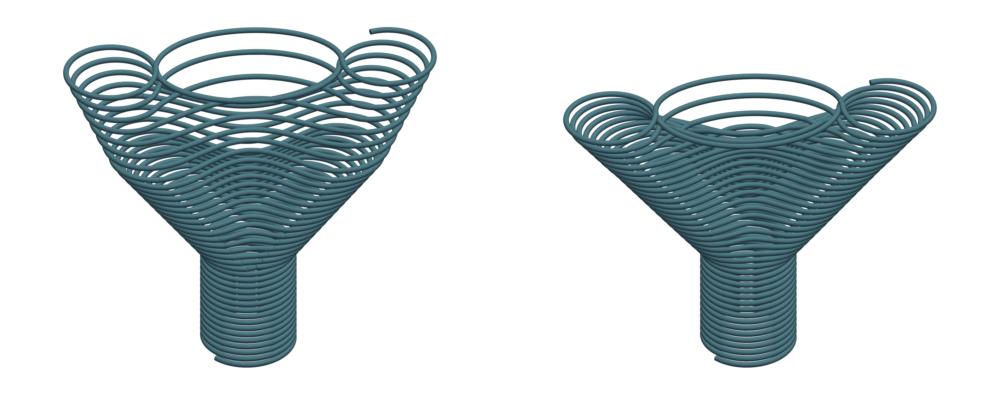

# autorigami

Design curved DNA nanostructures as spirals, and make them obey the curvature and separation limits of DNA.



*A branching tube as designed (left) and after gravity packing (right).*

## Install

```
uv sync
```

This compiles the C++ code.

## Start here

The notebooks are [marimo](https://marimo.io) files. Read them with their interactive 3D views:

1. [Design a spiral](https://marcosbolanos.github.io/autorigami/1_spiral_generation.html)
2. [Pack it under gravity](https://marcosbolanos.github.io/autorigami/2_gravity_based_packing.html)

Or run them: `uv run marimo edit notebooks/1_spiral_generation.py`.

## Layout

| Path | Contents |
|---|---|
| `src/autorigami/spiral_generation` | Spiral design |
| `src/autorigami/geometry` | Validation: curvature and separation |
| `src/autorigami/packing` | Gravity packing |
| `src/autorigami/viz` | 3D views for notebooks |
| `src/autorigami/mesh_io` | Mesh export and renders |
| `cpp` | Native code: distances and PhysX simulation |
| `tests` | Tests |

See [CONTRIBUTING.md](CONTRIBUTING.md) to develop.
